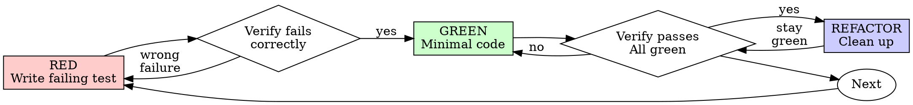

# Test-Driven Development (TDD)

## Overview

Write the test first. Watch it fail. Write minimal code to pass.

**Core principle:** A behavior regression test needs evidence that it detects the missing behavior, followed by a passing result after the fix.

**Violating the letter of the rules is violating the spirit of the rules.**

## When to Use

Use red-green-refactor for new runtime behavior and bug fixes. For refactoring, first establish relevant regression coverage and keep it passing; add a failing test when exposing a missing behavior.

For prose, formatting, generated output or configuration-only changes, use the checks that can detect the actual defect: parsing, schema/reference checks, lint, a build or an isolated command fixture. Configuration that changes runtime behavior still needs a behavior check when practical. Do not invent tests that merely repeat the implementation.

Reuse authorization and the accepted plan. These applicability choices do not require a new permission gate. If the required check is unavailable, state the gap and use the best applicable evidence without claiming a skipped check passed.

## The Iron Law

```
NEW BEHAVIOR: DEMONSTRATE A RELEVANT FAILURE, THEN IMPLEMENT AND VERIFY GREEN
```

### Recover safely when implementation came first

1. Inspect the current diff and ownership before changing anything. Preserve pre-existing, user and other-agent edits, including edits in the same file.
2. Write the test from the requirement, independently of the implementation details.
3. Demonstrate the expected failure against the pre-change behavior in an isolated copy/worktree or by temporarily reversing only your known owned patch. Preserve a recoverable copy, including new/untracked files, and restore it afterward. Never use blanket deletion, reset or checkout as TDD recovery.
4. If edits are interleaved or provenance is uncertain, keep the work intact and use an isolated reproduction. If you cannot safely establish red, report that limitation; do not label a passing-only test as a completed red-green cycle.
5. Implement or restore the smallest owned change and verify green, then run the relevant regression checks.

The goal is evidence that the test catches the defect, not erasing work to recreate the order of a past session.

## Red-Green-Refactor



### RED - Write Failing Test

Write one minimal test showing what should happen.

<Good>
```typescript
test('retries failed operations 3 times', async () => {
  let attempts = 0;
  const operation = () => {
    attempts++;
    if (attempts < 3) throw new Error('fail');
    return 'success';
  };

  const result = await retryOperation(operation);

  expect(result).toBe('success');
  expect(attempts).toBe(3);
});
```
Clear name, tests real behavior, one thing
</Good>

<Bad>
```typescript
test('retry works', async () => {
  const mock = jest.fn()
    .mockRejectedValueOnce(new Error())
    .mockRejectedValueOnce(new Error())
    .mockResolvedValueOnce('success');
  await retryOperation(mock);
  expect(mock).toHaveBeenCalledTimes(3);
});
```
Vague name, tests mock not code
</Bad>

**Requirements:**
- One behavior
- Clear name
- Real code (no mocks unless unavoidable)

### Verify RED - Watch It Fail

**MANDATORY. Never skip.**

```bash
<project-supported command selecting this test file>
```

Confirm:
- Test fails (not errors)
- Failure message is expected
- Fails because feature missing (not typos)

**Test passes?** Check whether the requirement is already satisfied or the test misses the change. For a new regression test, establish red safely using the recovery steps above; do not force an unrelated failure.

**Test errors?** Fix error, re-run until it fails correctly.

### GREEN - Minimal Code

Write simplest code to pass the test.

<Good>
```typescript
async function retryOperation<T>(fn: () => Promise<T>): Promise<T> {
  for (let i = 0; i < 3; i++) {
    try {
      return await fn();
    } catch (e) {
      if (i === 2) throw e;
    }
  }
  throw new Error('unreachable');
}
```
Just enough to pass
</Good>

<Bad>
```typescript
async function retryOperation<T>(
  fn: () => Promise<T>,
  options?: {
    maxRetries?: number;
    backoff?: 'linear' | 'exponential';
    onRetry?: (attempt: number) => void;
  }
): Promise<T> {
  // YAGNI
}
```
Over-engineered
</Bad>

Don't add features, refactor other code, or "improve" beyond the test.

### Verify GREEN - Watch It Pass

**MANDATORY.**

```bash
<project-supported command selecting this test file>
```

Confirm:
- Test passes
- Other tests still pass
- Output pristine (no errors, warnings)

**Test fails?** Fix code, not test.

**Other tests fail?** Fix now.

### REFACTOR - Clean Up

After green only:
- Remove duplication
- Improve names
- Extract helpers

Keep tests green. Don't add behavior.

### Repeat

Next failing test for next feature.

## Good Tests

| Quality | Good | Bad |
|---------|------|-----|
| **Minimal** | One thing. "and" in name? Split it. | `test('validates email and domain and whitespace')` |
| **Clear** | Name describes behavior | `test('test1')` |
| **Shows intent** | Demonstrates desired API | Obscures what code should do |

## Why Order Matters

**"I'll write tests after to verify it works"**

Tests written after code pass immediately. Passing immediately proves nothing:
- Might test wrong thing
- Might test implementation, not behavior
- Might miss edge cases you forgot
- You never saw it catch the bug

Test-first forces you to see the test fail, proving it actually tests something.

**"I already manually tested all the edge cases"**

Manual testing is ad-hoc. You think you tested everything but:
- No record of what you tested
- Can't re-run when code changes
- Easy to forget cases under pressure
- "It worked when I tried it" ≠ comprehensive

Automated tests are systematic. They run the same way every time.

**"Implementation already exists — how do I prove the regression test?"**

Preserve it. Test the requirement against a safe pre-change fixture or reverse only the owned fix in isolation. Observe the expected failure, restore the change and verify green. Existing coverage remains useful; do not misrepresent tests written afterward as tests that failed first.

**"TDD is dogmatic, being pragmatic means adapting"**

TDD IS pragmatic:
- Finds bugs before commit (faster than debugging after)
- Prevents regressions (tests catch breaks immediately)
- Documents behavior (tests show how to use code)
- Enables refactoring (change freely, tests catch breaks)

"Pragmatic" shortcuts = debugging in production = slower.

**"Tests after achieve the same goals - it's spirit not ritual"**

No. Tests-after answer "What does this do?" Tests-first answer "What should this do?"

Tests-after are biased by your implementation. You test what you built, not what's required. You verify remembered edge cases, not discovered ones.

Tests-first force edge case discovery before implementing. Tests-after verify you remembered everything (you didn't).

30 minutes of tests after ≠ TDD. You get coverage, lose proof tests work.

## Common Rationalizations

| Excuse | Reality |
|--------|---------|
| "Too simple to test" | Choose the smallest check that detects the relevant behavior defect. |
| "I'll test after" | Passing alone does not establish that a regression test catches the defect. |
| "Tests after achieve same goals" | Tests-after = "what does this do?" Tests-first = "what should this do?" |
| "Already manually tested" | Ad-hoc ≠ systematic. No record, can't re-run. |
| "Implementation is already written" | Preserve it; demonstrate the failure against pre-change behavior safely. |
| "Copy implementation into the assertion" | Derive assertions from requirements so they can expose an incorrect implementation. |
| "Need to explore first" | Isolate exploration from user work; use requirement-based checks for the final behavior. |
| "Test hard = design unclear" | Listen to test. Hard to test = hard to use. |
| "TDD will slow me down" | TDD faster than debugging. Pragmatic = test-first. |
| "Manual test faster" | Manual doesn't prove edge cases. You'll re-test every change. |
| "Existing code has no tests" | You're improving it. Add tests for existing code. |

## Red Flags - Inspect and Recover Safely

- Code before test
- Test after implementation
- Test passes immediately
- Can't explain why test failed
- Tests added "later"
- Rationalizing "just this once"
- "I already manually tested it"
- "Tests after achieve the same purpose"
- "It's about spirit not ritual"
- "Keep as reference" or "adapt existing code"
- "Already spent X hours, so a passing-only test proves the regression"
- "TDD is dogmatic, I'm being pragmatic"
- "This is different because..."

**These mean: stop extending the unverified behavior, preserve the current work, and follow the safe recovery steps.**

## Example: Bug Fix

**Bug:** Empty email accepted

**RED**
```typescript
test('rejects empty email', async () => {
  const result = await submitForm({ email: '' });
  expect(result.error).toBe('Email required');
});
```

**Verify RED**
```bash
$ npm test
FAIL: expected 'Email required', got undefined
```

**GREEN**
```typescript
function submitForm(data: FormData) {
  if (!data.email?.trim()) {
    return { error: 'Email required' };
  }
  // ...
}
```

**Verify GREEN**
```bash
$ npm test
PASS
```

**REFACTOR**
Extract validation for multiple fields if needed.

## Verification Checklist

Before marking work complete:

- [ ] New or changed behavior has meaningful coverage
- [ ] Observed the expected regression failure before the fix (or safely against pre-change behavior)
- [ ] Each test failed for expected reason (feature missing, not typo)
- [ ] Wrote minimal code to pass each test
- [ ] Applicable checks pass for the reviewed scope; skipped/unavailable checks are explicit
- [ ] New failures and warnings are investigated; pre-existing issues are distinguished
- [ ] Tests use real code (mocks only if unavoidable)
- [ ] Edge cases and errors covered

If a box is unmet, report the precise gap and address it within the owned scope. Do not delete unrelated work or claim unexecuted checks passed.

## When Stuck

| Problem | Solution |
|---------|----------|
| Don't know how to test | Write wished-for API. Write assertion first. Ask your human partner. |
| Test too complicated | Design too complicated. Simplify interface. |
| Must mock everything | Code too coupled. Use dependency injection. |
| Test setup huge | Extract helpers. Still complex? Simplify design. |

## Debugging Integration

Bug found? Write failing test reproducing it. Follow TDD cycle. Test proves fix and prevents regression.

For a behavior bug, establish a failing reproduction and verify the fix. For prose/config defects, use the applicable structural or isolated check described above.

## Testing Anti-Patterns

When adding mocks or test utilities, read @testing-anti-patterns.md to avoid common pitfalls:
- Testing mock behavior instead of real behavior
- Adding test-only methods to production classes
- Mocking without understanding dependencies

## Final Rule

```
Behavior change → expected failure demonstrated, then green
Prose/config-only change → applicable structural or isolated checks
Every path → preserve existing work and state the actual evidence
```

Follow explicit user constraints and the accepted plan; reuse existing authorization instead of adding a routine exception-approval loop.
