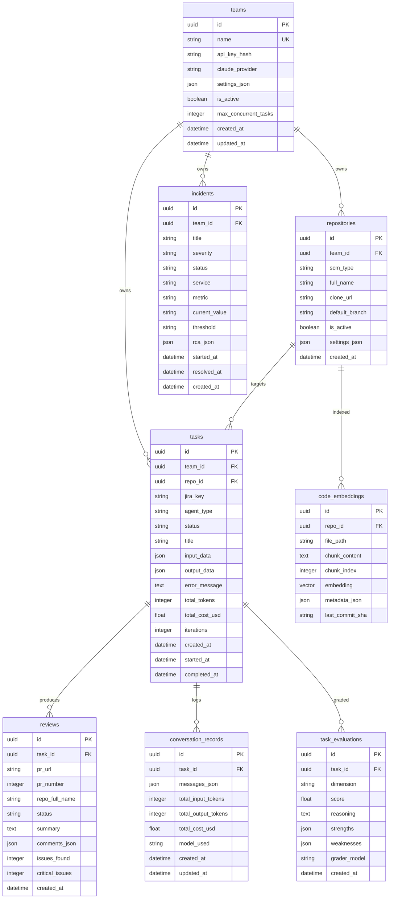

# Database ER Diagram

All 8 tables in PostgreSQL + pgvector. Shows columns, types, primary/foreign keys, and relationships.



## Table Descriptions

| Table | Purpose |
|-------|---------|
| **teams** | Multi-tenant org. Holds API key, Claude provider preference, concurrency limits |
| **repositories** | GitHub/Bitbucket repos registered for agent access |
| **tasks** | Central work unit. Tracks agent type, status, tokens, cost, iterations |
| **reviews** | Code review results with inline comments (file + line + severity) |
| **incidents** | DataDog alerts triaged by DevOps agent with RCA |
| **conversation_records** | Full Claude message history per task for audit/replay |
| **code_embeddings** | pgvector-indexed code chunks for RAG semantic search |
| **task_evaluations** | Per-dimension grading scores from evaluation system |

## Status Flow (tasks.status)

```
queued → planning → coding → testing → pr_created → completed
                                    ↘ failed
                         ↘ review_failed
                                          ↘ deploy_failed
```
