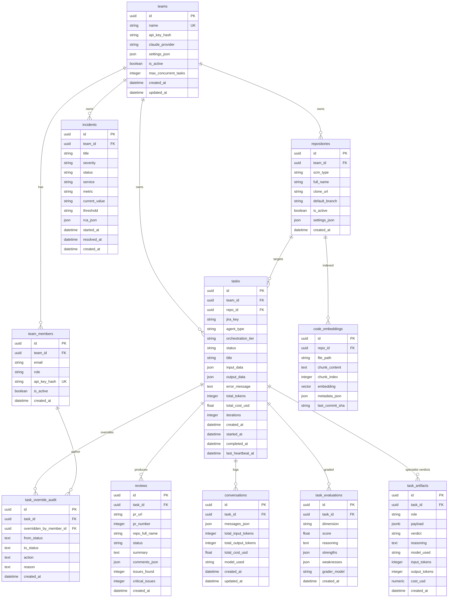

# Database ER Diagram

All 11 base tables in PostgreSQL + pgvector (excluding `alembic_version`).
Shows columns, types, primary/foreign keys, and relationships.



## Table Descriptions

| Table | Purpose |
|-------|---------|
| **teams** | Multi-tenant org. Holds team-level API key, Claude provider preference, concurrency limits |
| **team_members** | RBAC members per team. Role ∈ {owner, admin, member, viewer}. Optional per-member API key hash |
| **repositories** | GitHub/Bitbucket repos registered for agent access |
| **tasks** | Central work unit. Tracks agent type, orchestration tier, status, tokens, cost, iterations, heartbeat |
| **reviews** | Code review results with inline comments (file + line + severity) |
| **incidents** | DataDog alerts triaged by DevOps agent with RCA |
| **conversations** | Full Claude message history per task for audit/replay |
| **code_embeddings** | pgvector-indexed code chunks for RAG semantic search |
| **task_evaluations** | Per-dimension grading scores from evaluation system |
| **task_artifacts** | One row per (task_id, role) — specialist verdict, reasoning, payload, tokens, cost (NUMERIC micro-dollar). Enforced UNIQUE(task_id, role) |
| **task_override_audit** | Audit row per admin override or reaper auto-fail. Captures from_status → to_status, action ∈ {rerun_coding, rerun_qa, force_pass, reap}, and reason |

## Status Flow (tasks.status)

```
queued → running → (orchestrator) → coding → awaiting_qa → completed
                         ↓             ↓         ↓
                      blocked       failed    qa_failed
```

`blocked` — specialist verdict=block in live mode (pre-coding halt).
`awaiting_qa` — PR opened, QA specialist enqueued, verdict pending.
`qa_failed` — post-coding QA verdict=block. Terminal unless admin-overridden.
`cancelled` — user-initiated stop (not counted as failure).

Admin overrides can transition `blocked → coding`, `qa_failed → awaiting_qa`,
or `qa_failed → completed`; reapers write `*_stuck_reaped` into
`task_override_audit.reason` when a worker tier is stuck > 30 min.
