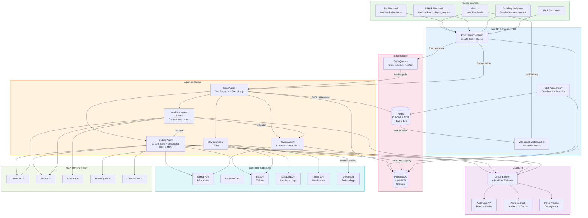

# System Architecture Overview

Full platform topology: triggers, API, agents, Claude providers, infrastructure, integrations, and MCP servers.

## Key Data Flows

| Flow | Path |
|------|------|
| **Task submission** | UI/Webhook → POST /api/chat/send → PostgreSQL → SQS (prod) or inline (debug) |
| **Real-time streaming** | Agent → Redis PUBLISH → WebSocket SUBSCRIBE → Browser |
| **Tool execution** | Agent → Tool Registry → External API (GitHub/Jira/DataDog) |
| **RAG search** | Agent → Voyage embed query → pgvector cosine + ts_rank → RRF merge |
| **Cost tracking** | Agent iteration → Redis INCR cost:{team}:{date} |
| **Evaluation** | Task complete → fire-and-forget → Haiku grades → PostgreSQL |
