# System Architecture Overview

Full platform topology: triggers, API, agents (core + specialists + orchestrator), Claude providers, infrastructure, integrations, and MCP servers.

```mermaid
flowchart TD
    subgraph Triggers["Trigger Sources"]
        UI["Web UI\nNew Run Modal"]
        JIRA["Jira Webhook\n/webhooks/jira/issue"]
        GH["GitHub Webhook\n/webhooks/github/pull_request"]
        DD["DataDog Webhook\n/webhooks/datadog/alert"]
        SLACK["Slack Command"]
    end

    subgraph API["FastAPI Backend :8888"]
        CHAT["POST /api/chat/send\nCreate Task + Queue"]
        WS["WS /api/chat/stream/{id}\nReal-time Events"]
        ADMIN["GET /api/admin/*\nDashboard + Analytics\n+ override/reap endpoints"]
    end

    subgraph Core["Core Agents (SDK tool loops)"]
        BASE["BaseAgent\nTool Registry + Event Loop"]
        CODING["Coding Agent\n14 core tools + conditional RAG + MCP"]
        REVIEW["Review Agent\n12 tools + shared RAG"]
        DEVOPS["DevOps Agent\n7 tools"]
    end

    subgraph Orchestration["Orchestration Layer"]
        ORCH["Orchestrator Wrapper\nclassifier → tier plan → fan-out"]
        QAPOST["QA Post-Coding Wrapper\nvalidates PR diff"]
    end

    subgraph Specialists["Specialists (pure LLM envelope, no tools by default)"]
        BA["BusinessAnalyst"]
        STK["StackAnalyst (1 tool)"]
        SEC["Security"]
        TL["TechLead"]
        UX["UxDesigner"]
        APT["ApiTest"]
        QA["QA (3 tools — post-coding)"]
    end

    subgraph Claude["Claude AI"]
        ANTHROPIC["Anthropic API\nDirect + Cache"]
        BEDROCK["AWS Bedrock\nIAM Auth + Cache"]
        MOCK["Mock Provider\nDebug Mode"]
        CB["Circuit Breaker\n+ Resilient Fallback"]
    end

    subgraph Infra["Infrastructure"]
        PG[("PostgreSQL\n+ pgvector\n11 tables")]
        REDIS[("Redis\nPub/Sub + Cost\n+ Event Log")]
        SQS["SQS Queues (5)\ntask / review / devops\norchestrator / qa"]
    end

    subgraph Integrations["External Integrations"]
        GITHUB["GitHub API\nPR + Code"]
        BITBUCKET["Bitbucket API"]
        JIRAAPI["Jira API\nTickets"]
        DDAPI["DataDog API\nMetrics + Logs"]
        SLACKAPI["Slack API\nNotifications"]
        VOYAGE["Voyage AI\nEmbeddings"]
    end

    subgraph MCP["MCP Servers (stdio)"]
        MCP_GH["GitHub MCP"]
        MCP_JIRA["Jira MCP"]
        MCP_SLACK["Slack MCP"]
        MCP_DD["DataDog MCP"]
        MCP_CTX["Context7 MCP"]
    end

    UI --> CHAT
    JIRA --> CHAT
    GH --> CHAT
    DD --> CHAT
    SLACK --> CHAT

    CHAT --> PG
    CHAT -->|"Debug: inline"| BASE
    CHAT -->|"Prod: enqueue orchestrator"| SQS
    SQS -->|"orchestrator worker"| ORCH

    ORCH --> BA
    ORCH --> STK
    ORCH --> SEC
    ORCH --> TL
    ORCH --> UX
    ORCH --> APT

    ORCH -->|"all pass: re-enqueue coding"| SQS
    SQS -->|"task queue"| CODING
    CODING -->|"PR opened: enqueue qa"| SQS
    SQS -->|"qa queue"| QAPOST
    QAPOST --> QA

    SQS -->|"review queue"| REVIEW
    SQS -->|"devops queue"| DEVOPS

    BASE --> CODING
    BASE --> REVIEW
    BASE --> DEVOPS

    CODING --> CB
    REVIEW --> CB
    DEVOPS --> CB
    ORCH --> CB
    QAPOST --> CB

    CB --> ANTHROPIC
    CB --> BEDROCK
    CB --> MOCK

    CODING --> GITHUB
    CODING --> JIRAAPI
    REVIEW --> GITHUB
    DEVOPS --> DDAPI
    DEVOPS --> SLACKAPI
    DEVOPS --> JIRAAPI

    CODING --> MCP_GH
    CODING --> MCP_JIRA
    CODING --> MCP_CTX
    DEVOPS --> MCP_DD

    BASE -->|"PUBLISH events"| REDIS
    REDIS -->|"SUBSCRIBE"| WS
    WS -->|"WebSocket"| UI

    BASE --> PG
    ORCH -->|"task_artifacts writes"| PG
    QAPOST -->|"task_artifacts + status"| PG
    CODING -->|"RAG index/query"| PG
    CODING -->|"Embed chunks"| VOYAGE

    ADMIN --> PG
    ADMIN --> REDIS

    style Triggers fill:#e8f5e9,stroke:#4caf50
    style API fill:#e3f2fd,stroke:#2196f3
    style Core fill:#fff3e0,stroke:#ff9800
    style Orchestration fill:#ffe0b2,stroke:#f57c00
    style Specialists fill:#fff9c4,stroke:#fbc02d
    style Claude fill:#f3e5f5,stroke:#9c27b0
    style Infra fill:#fce4ec,stroke:#e91e63
    style Integrations fill:#e0f7fa,stroke:#00bcd4
    style MCP fill:#f1f8e9,stroke:#8bc34a
```

## Agent Roster

| Agent | Tools | Role |
|-------|-------|------|
| **Coding** | 14 core + conditional RAG + MCP | Implements the change, opens PR |
| **Review** | 12 + shared RAG | Reviews PR diff, posts inline comments |
| **DevOps** | 7 | Incident triage, Slack notify, Jira update |
| **Orchestrator** | 0 SDK tools (direct specialist invocation) | Classifies ticket, fans out specialists, gates coding |
| **QA (post-coding)** | 3 | Validates PR diff against AC + security rules |
| **BusinessAnalyst / Security / TechLead / UxDesigner / ApiTest** | 0 (pure LLM envelope) | Domain-specific advisory verdicts written to `task_artifacts` |
| **StackAnalyst** | 1 | Repo stack inference |

## SQS Queue Inventory

| Queue | Consumer | Purpose |
|-------|----------|---------|
| `task` | Coding worker | Coding-agent tasks (including re-enqueues from orchestrator) |
| `review` | Review worker | Review-agent tasks |
| `devops` | DevOps worker | Incident/alert handling |
| `orchestrator` | Orchestrator worker | Runs classifier + specialists, re-enqueues coding-task |
| `qa` | QA post-coding worker | Validates PR diff after coding completes |

## Key Data Flows

| Flow | Path |
|------|------|
| **Primary task submission** | UI/Webhook → POST /api/chat/send → PostgreSQL → SQS `orchestrator` queue |
| **Specialist fan-out** | Orchestrator worker → tier plan → specialist LLM calls → `task_artifacts` rows → (all pass) re-enqueue coding-task to `task` queue |
| **Post-coding QA** | Coding completes with PR → enqueue to `qa` queue → QaPostCodingWrapper → QA specialist → verdict=pass ⇒ `completed`, verdict=block ⇒ `qa_failed` |
| **Real-time streaming** | Agent → Redis PUBLISH → WebSocket SUBSCRIBE → Browser |
| **Tool execution** | Agent → Tool Registry → External API (GitHub/Jira/DataDog) |
| **RAG search** | Agent → Voyage embed query → pgvector cosine + ts_rank → RRF merge |
| **Cost tracking** | Agent iteration → Redis INCR `cost:{team}:{date}`; per-artifact cost stored in `task_artifacts.cost_usd` (NUMERIC micro-dollar) |
| **Admin override / reaper** | POST /api/admin/tasks/{id}/override-block → status transition + `task_override_audit` row in same DB transaction |
