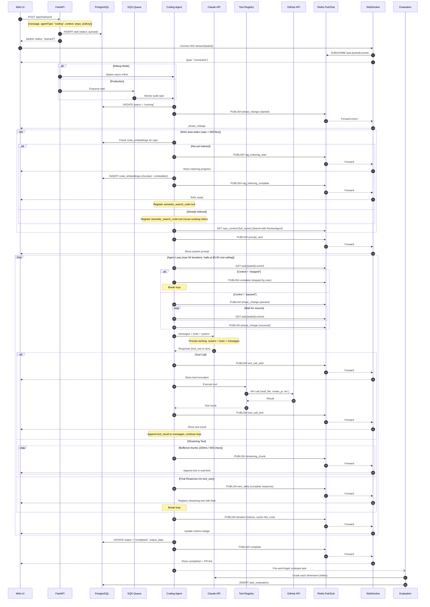

# Coding Agent — Request Flow Sequence

Step-by-step flow from user click to real-time streaming response, including tool calls, prompt caching, and evaluation.

## Event Types Published

| Event | When | Data |
|-------|------|------|
| `phase_change` | Agent starts | `{phase: "started"}` |
| `prompt_sent` | Before first Claude call | `{system: "...", user: "..."}` |
| `tool_call_start` | Tool invoked | `{name, input}` |
| `tool_call_end` | Tool finished | `{name, duration_ms, success, result}` |
| `streaming_chunk` | Every 200ms or 500 chars (buffered text deltas) | `{content, iteration}` |
| `response_chunk` | After each Claude response text | `{content, iteration}` |
| `rag_indexing_start` | RAG auto-index begins | `{repo, estimated_files}` |
| `rag_indexing_complete` | RAG auto-index finished | `{repo, chunks}` |
| `iteration` | After each Claude response | `{iteration, input_tokens, output_tokens, total_input_tokens, total_output_tokens, has_tool_use, stop_reason, cache_read_tokens, cache_creation_tokens}` |
| `text_delta` | Final response text | `{text}` |
| `complete` | Task done | `{success, iterations, total_tokens, cost}` |
| `error` | Task failed | `{message}` |
