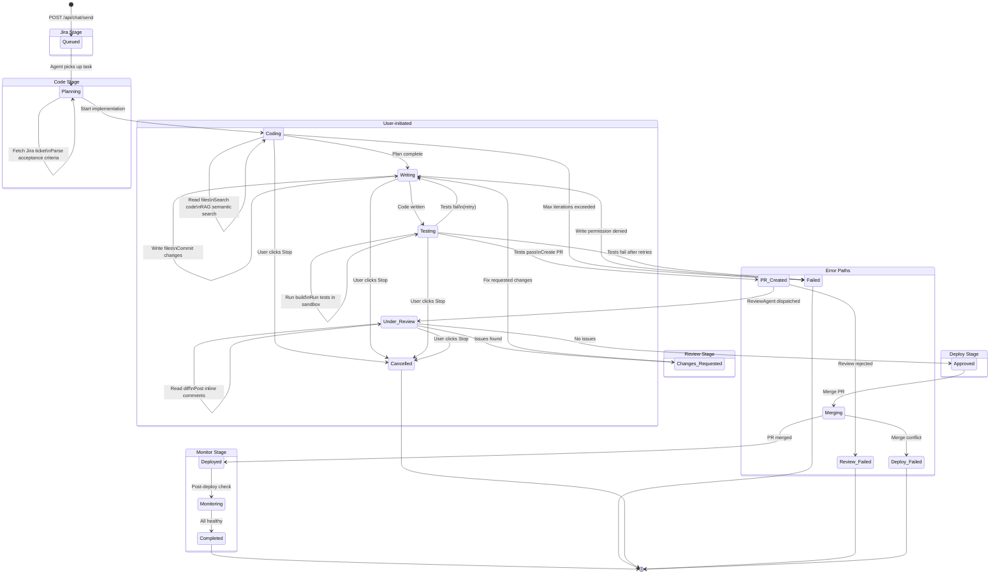

# Task State Machine

All states across the 5 pipeline stages (Jira → Code → Review → Deploy → Monitor) with transitions and error paths.



> **`cancelled` vs `failed`**: a user-initiated stop is **not** a failure. Keeping them separate avoids polluting `successRate` metrics with deliberate user cancels.

## Pipeline Stage ↔ Task Status Mapping

| Task Status | Pipeline Stage | Stage Status | UI Shows | Rule |
|-------------|---------------|--------------|----------|------|
| `queued` | Code | queued | Coding (pulsing) | |
| `planning` | Code | active | Coding (pulsing) | |
| `running` | Code | active | Coding (pulsing) | |
| `coding` | Code | active | Coding (pulsing) | |
| `testing` | Review | active | In Review | |
| `pr_created` | Review | active | In Review | |
| `review_failed` | Review | failed | Blocked | |
| `deploy_failed` | Deploy | failed | Blocked | |
| `completed` | Monitor | passed | **Merged** | Human assignee reviewed and merged the PR |
| `completed` | Monitor | passed | **Deployed** | AI agent completed the full pipeline autonomously |
| `cancelled` | _(terminal)_ | cancelled | **Stopped by user** | User-initiated stop; excluded from successRate KPI |
| `failed` | Monitor | failed | Blocked | |

## Backend Mapping (router.py)

```python
_STATUS_TO_STAGE = {
    "queued": "code",
    "planning": "code",
    "running": "code",
    "coding": "code",
    "testing": "review",
    "pr_created": "review",
    "review_failed": "review",
    "deploy_failed": "deploy",
    "completed": "monitor",
    "cancelled": "monitor",
    "failed": "monitor",
}

_STATUS_TO_STAGE_STATUS = {
    "queued": "queued",
    "planning": "active",
    "running": "active",
    "coding": "active",
    "testing": "active",
    "pr_created": "active",
    "review_failed": "failed",
    "deploy_failed": "failed",
    "completed": "passed",
    "cancelled": "cancelled",
    "failed": "failed",
}
```
