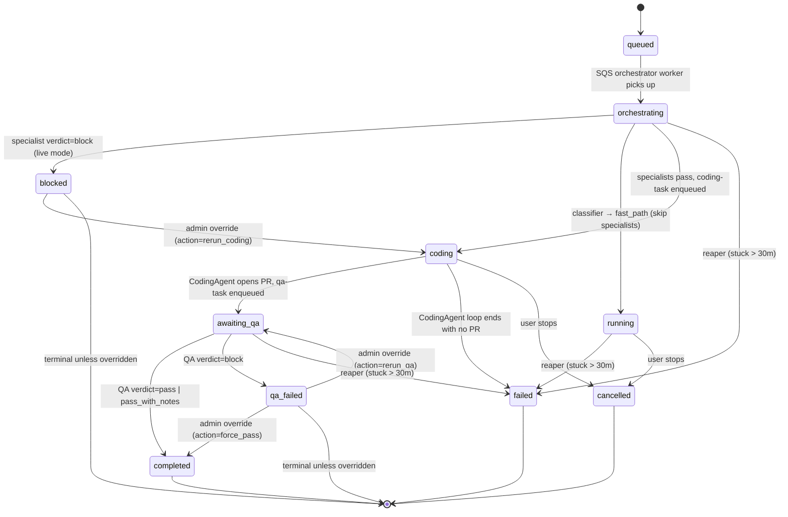

# Task State Machine

All Task statuses recognised by the API and worker tiers. For the
operator-oriented view (envelope, alerts, rollback) see
[`docs/runbooks/06-orchestrator.md`](../runbooks/06-orchestrator.md) — this
doc is the architectural reference.



> **`cancelled` vs `failed`**: a user-initiated stop is **not** a failure.
> Keeping them separate avoids polluting `successRate` metrics with
> deliberate user cancels.

## Invariants

- Every transition is written by a single worker
  (orchestrator → coding → qa) or by the admin override / reaper path.
  No code path writes `status` twice in the same request.
- The outer SQS `_process_message` respects wrapper-committed terminal
  states (`blocked`, `qa_failed`) and does NOT overwrite them with
  `completed` when the wrapper returns a successful `AgentResult`.
  Gating decisions are preserved.
- The allowed `status` set is enforced by the `ck_tasks_status` check
  constraint (see Alembic migrations adding `blocked`, `awaiting_qa`,
  `qa_failed`).
- Every admin override / reaper auto-fail writes a row to
  `task_override_audit` in the same transaction as the `tasks.status`
  update — the audit trail cannot diverge from the authoritative status.

## Pipeline Stage ↔ Task Status Mapping

The admin Timeline UI projects each Task's `status` onto a
(`stage`, `stageStatus`) pair. A per-agent override in
`_AGENT_COMPLETED_STAGE` promotes `completed` into the right stage
depending on which agent produced it.

| Task Status | Stage | Stage Status | UI pill |
|-------------|-------|--------------|---------|
| `queued` | jira | queued | Queued |
| `planning` | jira | active | Coding |
| `running` | code | active | Coding |
| `coding` | code | active | Coding |
| `testing` | code | active | Coding |
| `pr_created` | review | active | Reviewing |
| `reviewing` | review | active | Reviewing |
| `review_passed` | deploy | passed | Deploying |
| `review_failed` | review | failed | Blocked |
| `deploying` | deploy | active | Deploying |
| `deploy_failed` | deploy | failed | Blocked |
| `deployed` | monitor | passed | Deployed |
| `monitoring` | monitor | active | Monitoring |
| `completed` (coding agent) | review | passed | PR Open |
| `completed` (workflow / devops) | monitor | passed | Deployed |
| `cancelled` | code | cancelled | Cancelled |
| `failed` | code | failed | Blocked |
| `blocked` | code | failed | Blocked |
| `awaiting_qa` | review | active | Reviewing |
| `qa_failed` | review | failed | Blocked |

The `_AGENT_COMPLETED_STAGE` override is skipped for `blocked` /
`awaiting_qa` / `qa_failed` so a specialist-halted task doesn't
mis-render as "In review."

## Backend Mapping (admin/router.py)

```python
_STATUS_TO_STAGE: dict[str, str] = {
    "queued": "jira",
    "planning": "jira",
    "running": "code",
    "coding": "code",
    "testing": "code",
    "pr_created": "review",
    "reviewing": "review",
    "review_passed": "deploy",
    "review_failed": "review",
    "deploying": "deploy",
    "deploy_failed": "deploy",
    "deployed": "monitor",
    "monitoring": "monitor",
    "completed": "deploy",    # overridden per-agent below
    "failed": "code",
    "cancelled": "code",
    "blocked": "code",
    "awaiting_qa": "review",
    "qa_failed": "review",
}

_AGENT_COMPLETED_STAGE: dict[str, str] = {
    "coding": "review",
    "review": "review",
    "devops": "monitor",
    "workflow": "monitor",
}

_STATUS_TO_STAGE_STATUS: dict[str, str] = {
    "queued": "queued",
    "planning": "active",
    "running": "active",
    "coding": "active",
    "testing": "active",
    "pr_created": "active",
    "reviewing": "active",
    "review_passed": "passed",
    "review_failed": "failed",
    "deploying": "active",
    "deploy_failed": "failed",
    "deployed": "passed",
    "monitoring": "active",
    "completed": "passed",
    "failed": "failed",
    "cancelled": "cancelled",
    "blocked": "failed",
    "awaiting_qa": "active",
    "qa_failed": "failed",
}
```
