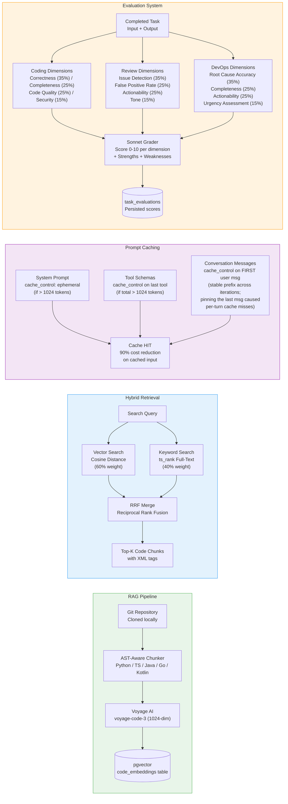

# RAG, Prompt Caching & Evaluation

Three cross-cutting subsystems that enhance agent quality and cost efficiency.



## RAG Details

### Auto-Enable Logic
- Triggered when repo has > 500 files (configurable via `rag_auto_enable_file_threshold`)
- Checks `code_embeddings` for existing index with matching `last_commit_sha`
- If not indexed: publishes `rag_indexing_start` event, indexes all chunks, publishes `rag_indexing_complete`
- Stores context in Redis: `repo_context:{full_name}` (shared with ReviewAgent)

### AST-Aware Chunkers

| Language | Strategy | Boundaries |
|----------|----------|------------|
| Python | AST parse | Top-level functions, classes, module preamble |
| TypeScript/JS | Regex | `function`, `class`, `interface`, `type`, `const ... = () =>` |
| Java | Regex | `public/private/protected (static)? class/void/...` |
| Go | Regex | `func`, `type ... struct`, `type ... interface` |
| Kotlin | Regex | `fun`, `class`, `object`, `interface` |
| Other | Fixed-size | 1000 chars, line-aligned |

### Hybrid Retrieval (RRF)
```
score(doc) = 0.6 / (k + vector_rank) + 0.4 / (k + keyword_rank)
```
- k = 60 (standard RRF constant)
- Vector: Voyage v3 cosine distance on pgvector
- Keyword: PostgreSQL `plainto_tsquery` + `ts_rank`

## Prompt Caching

### Cache Processing Order
`tools → system → messages` (Anthropic requirement)

### Cache Rules
- Minimum 1024 tokens per cacheable block
- Max 4 breakpoints per request
- 1-hour TTL
- Any byte change invalidates everything after the breakpoint
- Applied to both Anthropic and Bedrock providers

### Cost Impact
- Cache write: 25% surcharge on first request
- Cache read: 90% discount on subsequent requests
- Net savings on multi-turn conversations: ~70-80%

## Evaluation Dimensions

### Coding Agent
| Dimension | Weight | What it measures |
|-----------|--------|-----------------|
| Correctness | 35% | Does the output correctly address the requirements? Are there bugs or logic errors? |
| Completeness | 25% | Does the output cover all requirements? Are edge cases handled? |
| Code Quality | 25% | Is the code well-structured, readable, and following best practices? |
| Security | 15% | Are there security vulnerabilities? Are inputs validated properly? |

### Review Agent
| Dimension | Weight | What it measures |
|-----------|--------|-----------------|
| Issue Detection | 35% | Does the review correctly identify real bugs, logic errors, and code smells? |
| False Positive Rate | 25% | Are the flagged issues legitimate? Are there false alarms? |
| Actionability | 25% | Are review comments specific, actionable, with concrete fix suggestions? |
| Tone | 15% | Is the review constructive, professional, and balanced? |

### DevOps Agent
| Dimension | Weight | What it measures |
|-----------|--------|-----------------|
| Root Cause Accuracy | 35% | Is the root cause analysis correct and evidence-based? |
| Completeness | 25% | Does the analysis cover all relevant signals (metrics, logs, deployments)? |
| Actionability | 25% | Are the recommended actions specific, prioritized, and feasible? |
| Urgency Assessment | 15% | Is the severity/priority assessment appropriate for the situation? |
