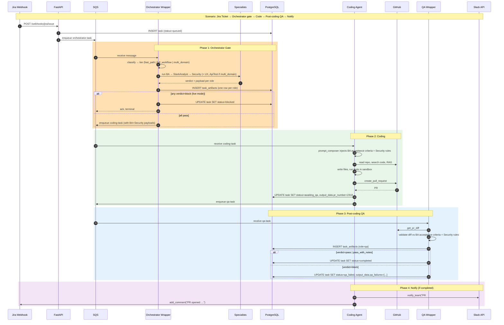

# Ticket → Merge — End-to-End Pipeline

Primary path: Jira webhook → Orchestrator (classifier + specialists) →
Coding (with injected BA + Security context) → PR → post-coding QA →
`completed` or `qa_failed`. Slack notification via DevOps agent or direct
coding-agent tool.

Operator-oriented counterpart: [`docs/runbooks/06-orchestrator.md`](../runbooks/06-orchestrator.md).

## Tier Routing

| Tier | Specialists (pre-coding) | Triggered by |
|------|--------------------------|---------------|
| `fast_path` | none (orchestrator skipped) | Trivial copy / config changes |
| `full_workflow` | BusinessAnalyst → StackAnalyst → Security (+ TechLead / UxDesigner if picked) | Single-domain changes |
| `multi_domain` | BA → StackAnalyst → TechLead → Security (+ UxDesigner / ApiTest if picked) | Changes spanning frontend + backend + infra |

Source of truth: `backend/src/ai_driven/agents/orchestrator/routing.py::TIER_RULES`.
QA is NOT a pre-coding specialist — it runs post-coding against the real
PR diff. See task T22 brief for rationale.

## Specialist → Coding Context Injection

When specialists pass, the orchestrator re-enqueues the coding-task with
the specialist payloads attached. The coding agent's prompt composer
(T18/T19) injects:

- **BA payload** → concrete acceptance criteria at the top of the
  user-prompt envelope.
- **Security payload** → enforced rules and PII/auth constraints.
- **StackAnalyst payload** → language / framework signals to bias
  tool-use (e.g., test runner selection).

Other specialist payloads (TechLead, UX, ApiTest) are persisted to
`task_artifacts` for audit and UI display but not injected into the
coding prompt by default.

## Error Paths

| Failure | Status | Recovery |
|---------|--------|----------|
| Specialist verdict=block (live) | `blocked` | Admin override `rerun_coding` re-enqueues coding with block ignored |
| Coding loop ends without PR | `failed` | Reaper or admin override |
| Stuck > 30 min at `orchestrating` / `running` / `awaiting_qa` | reaped to `failed` | Written by `backend/src/ai_driven/background/reapers.py`; see runbook |
| QA verdict=block | `qa_failed` | Admin override: `rerun_qa` (cheap, single invocation) or `force_pass` |
| Specialist returns `verdict=error` (Bedrock flake) | Treated as `pass` when `AI_DRIVEN_ORCHESTRATOR_TREAT_ERRORS_AS_PASS=true` (default) | Counter `orchestrator.specialist.fallback_activated{role}` |

## Legacy Workflow Agent Path — removed

The legacy `WorkflowAgent` (with `dispatch_coding_agent`,
`dispatch_review_agent`, `merge_pull_request`, `notify_team`,
`check_task_status` tools) was removed after its responsibilities were
fully absorbed by the Orchestrator Wrapper (specialist fan-out +
gating) and the post-coding QA wrapper (PR-diff validation). The SQS
consumer factory never routed `agent_type="workflow"` messages, so the
path was only reachable via the debug/inline chat route; it is deleted
in full as of the `WorkflowAgent` removal PRs. Historical
`tasks.agent_type='workflow'` rows are backfilled to `'coding'` by
migration `b3c4d5e6f7a8`.
