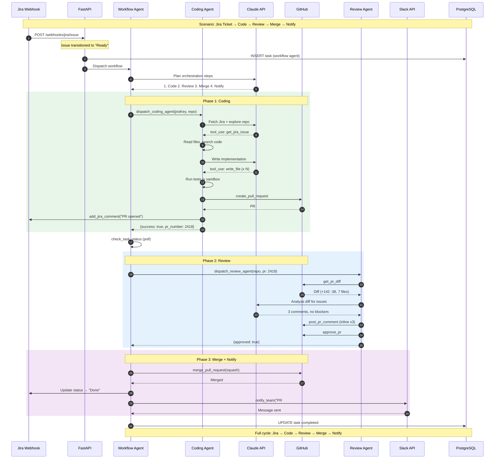

# Workflow Agent — End-to-End Pipeline

Full Jira-to-merge scenario: Jira webhook triggers Workflow Agent, which orchestrates Coding Agent → Review Agent → merge → notify.



## Workflow Agent Tools

| Tool | Purpose |
|------|---------|
| `dispatch_coding_agent` | Enqueue coding task, returns task_id |
| `dispatch_review_agent` | Enqueue review task for a PR |
| `check_task_status` | Poll task state via DynamoDB TaskStateMachineStore |
| `merge_pull_request` | Merge via GitHub/Bitbucket (squash/merge/rebase) |
| `notify_team` | Send Slack message to channel (supports channel override) |
| `mcp_*` | Additional MCP tools (GitHub, Jira, Slack) registered at startup if enabled |

## Orchestration Pattern

```
1. Parse input (Jira key, repo, branch)
2. Dispatch CodingAgent → poll until completed
3. Dispatch ReviewAgent → poll until approved
4. Merge PR (squash by default)
5. Update Jira status → "Done"
6. Notify team via Slack
7. Mark workflow task as completed
```

## Error Handling

- If CodingAgent fails → workflow fails, Jira comment posted with error
- If ReviewAgent requests changes → CodingAgent re-dispatched with feedback
- If merge conflicts → workflow reports blocked status
- Max polling attempts: 60 (with 10s intervals = 10min timeout per sub-task)
