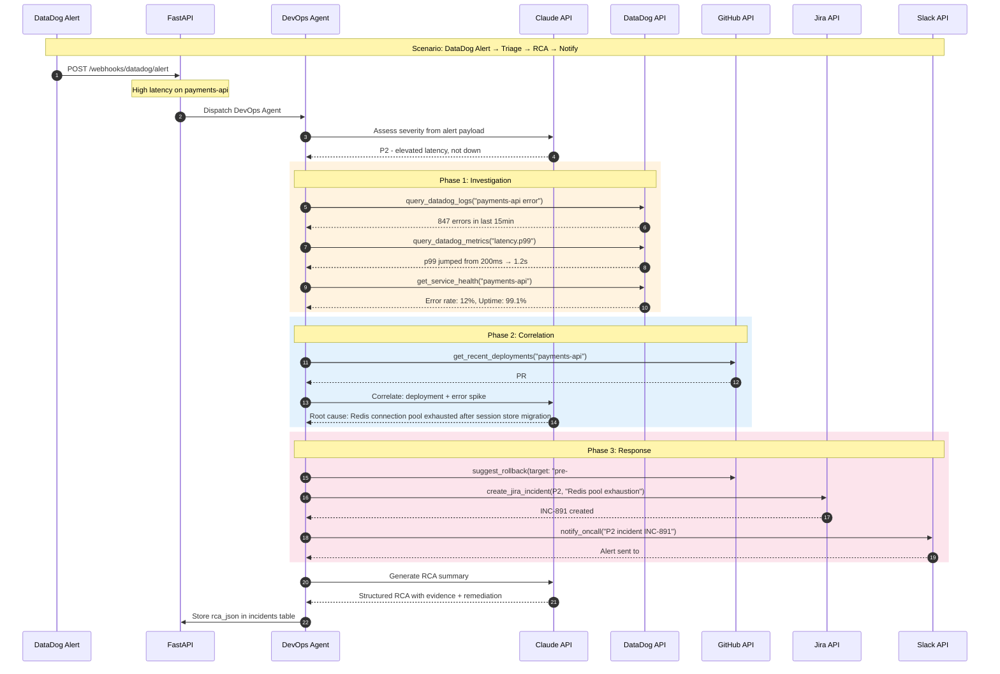

# DevOps Agent — Incident Response Flow

DataDog alert triggers investigation: query logs/metrics, correlate with deployments, generate RCA, create Jira ticket, notify on-call.



## DevOps Agent Tools

| Tool | Purpose |
|------|---------|
| `query_datadog_logs` | Search logs by query string and time range (ISO 8601) |
| `query_datadog_metrics` | Fetch metric timeseries (Unix epoch seconds) |
| `get_service_health` | APM health: error rate, latency, uptime |
| `get_recent_deployments` | List recent merged PRs as deployment markers |
| `create_jira_incident` | Create Bug ticket with priority + labels |
| `notify_oncall` | Send Slack alert to on-call channel |
| `suggest_rollback` | Identify last safe deployment before incident |

## RCA Output Structure

```json
{
  "root_cause": "Redis connection pool exhaustion after session store migration",
  "confidence": "high",
  "evidence": [
    "847 errors in 15min window correlating with deployment",
    "p99 latency spike from 200ms to 1.2s",
    "PR #2415 (session store migration) merged 22min before alert"
  ],
  "remediation": [
    "Immediate: Increase Redis maxclients and connection pool size",
    "Short-term: Add connection pool monitoring alert",
    "Long-term: Implement connection pooling with PgBouncer pattern"
  ],
  "rollback_target": "commit before PR #2415 merge"
}
```

## Severity Classification

Canonical taxonomy: **P1, P2, P3, P4 (uppercase)** — must match `features/04-ai-devops-assistant.md`.

| Severity | Criteria | Auto-actions |
|----------|----------|-------------|
| **P1** — Critical | Service down, data loss risk, >50% errors | Immediate Slack + Jira + page on-call + suggest rollback |
| **P2** — High | Degraded performance, 5-50% errors, feature broken | Slack + Jira + investigate + suggest rollback |
| **P3** — Medium | Minor degradation, <5% errors | Jira + Slack |
| **P4** — Low | Warning threshold, no user impact | Jira only |

> Note: Review-comment severity (`critical | warning | suggestion`) is a **different axis** — do not conflate with incident severity.
