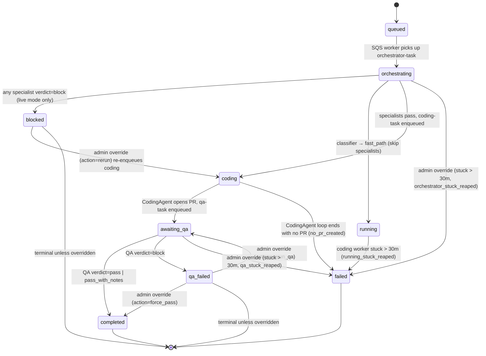

# Orchestrator Phase 2 — Operator Runbook

**Last verified:** 2026-05-01 (post-cutover). Update this line and the
"Known false positives" section every time you change orchestrator state,
alerting, or env flags. A stale runbook is worse than no runbook.

**Current mode:** `live` (flipped 2026-05-01). `.env.local` pins the value
explicitly; any deployment env should do the same rather than relying on the
`shadow` default in `config.py`.

---

## Overview

The orchestrator is the SQS-worker gate that sits between ticket submission
and `CodingAgent`. It classifies the ticket, runs a sequence of specialists
(BA, Security, StackAnalyst, UX, API-Test), optionally halts the pipeline on
a blocking verdict, then enqueues the coding-task. After the coding-task
opens a PR, a **post-coding** QA specialist validates the diff; its verdict
decides whether the Task finishes as `completed` or `qa_failed`.

Three tiers (from `routing.py`):

| Tier | Specialists invoked | Typical ticket |
|---|---|---|
| `fast_path` | none (orchestrator skipped entirely) | trivial copy change, config tweak |
| `full_workflow` | BA → StackAnalyst → Security | single-domain change touching one module |
| `multi_domain` | BA → StackAnalyst → Security → UX → API-Test | change spanning frontend + backend + infra |

Specialist implementations live under `src/ai_driven/agents/specialists/<role>/`.
The orchestrator wrapper that SQS invokes is
`src/ai_driven/queue/consumer.py::_OrchestratorWrapper`. The pure
classification-and-fan-out logic is `src/ai_driven/agents/orchestrator/agent.py`.

---

## State machine



Status values are enforced by `ck_tasks_status` (see Alembic migrations
adding `blocked`, `awaiting_qa`, `qa_failed`). Every transition is written by
a single worker (orchestrator → coding → qa) or the admin override endpoint;
no code path writes status twice in the same request. The outer SQS
`_process_message` respects wrapper-committed terminal states (`blocked`,
`qa_failed`) and does NOT overwrite them with `completed` when the wrapper
returns a successful AgentResult — gating decisions are preserved.

### Timeline stage mapping (admin UI)

`GET /api/admin/pipeline/runs` projects each Task's `status` onto a
(`stage`, `stageStatus`) pair consumed by the Timeline UI. The projections:

| status | stage | stageStatus | UI pill |
|---|---|---|---|
| `queued` / `planning` | `jira` | `queued` / `active` | Queued / Coding |
| `running` / `coding` / `testing` | `code` | `active` | Coding |
| `blocked` | `code` | `failed` | Blocked |
| `awaiting_qa` | `review` | `active` | Reviewing |
| `qa_failed` | `review` | `failed` | Blocked |
| `completed` (coding agent) | `review` | `passed` | PR Open |
| `completed` (workflow agent) | `monitor` | `passed` | Deployed |
| `failed` | `code` | `failed` | Blocked |
| `cancelled` | `code` | `cancelled` | Cancelled |

The `_AGENT_COMPLETED_STAGE` override (coding agent ⇒ `review`) is skipped
for `blocked` / `awaiting_qa` / `qa_failed` so a specialist-halted task
doesn't mis-render as "In review."

---

## Env flags

| Flag | Values | Default | What it does |
|---|---|---|---|
| `AI_DRIVEN_ORCHESTRATOR_MODE` | `shadow` \| `live` \| `off` | `shadow` | `shadow`: run specialists for telemetry only, always enqueue coding-task (Phase 1 behaviour). `live`: strict gating — specialist `verdict=block` halts the pipeline and sets `Task.status=blocked`. `off`: skip orchestrator entirely. |
| `AI_DRIVEN_ORCHESTRATOR_TREAT_ERRORS_AS_PASS` | `true` \| `false` | `true` | When `true`, specialists that return `verdict=error` (Bedrock flake, throttle, credit exhaustion) are treated as `pass` for gating purposes — persisted for audit, downstream specialists receive an empty prior_artifact. Prevents infra flakes from halting pipelines. Flip to `false` for T0-style strict measurement. |

The mode is **stamped on each SQS message at enqueue time** in `producer.py`
— in-flight messages during a mode flip keep their original mode so the
flip is safe mid-deploy. The worker reads the stamped value, NOT the
current env var.

---

## Teams & auth

The DB always has these two system-owned rows (seeded by migration
`f6a7b8c9d0e1_add_task_override_audit`):

| id | name | email | purpose |
|---|---|---|---|
| `00000000-0000-0000-0000-000000000000` | `admin` | — | ops team — authenticates human operators |
| `00000000-0000-0000-0000-000000000001` | — | `admin@ai-driven.local` | team_member row referenced by reaper + override_audit writes |

The `admin` team ships with `api_key_hash = '__seed__'` — a non-SHA256-shaped
sentinel that can never match a hashed input. **It is NOT usable as-is.**
Operators MUST rotate to a real key before first use, either via
`POST /api/admin/teams/{admin_id}/rotate-key` (requires an already-working key
for auth — bootstrap via DB), or via a direct DB update that replaces
`api_key_hash` with `sha256(<new-plaintext-key>)` and prints the plaintext once.

Every other team the operator creates is a normal owner-keyed team; role
checks (`require_admin`) accept `owner` and `admin` roles interchangeably.

---

## Common tasks

### Task stuck at `awaiting_qa`

1. In DB, check `Task.output_data.qa_enqueued_at` and `pr_number`. If
   `qa_enqueued_at` is older than ~30 min, the qa-worker never picked it up
   or crashed without acking.
2. The `qa_stuck` reaper (see `src/ai_driven/background/reapers.py`) should
   catch this within 5 min — check DataDog counter `reaper.qa.reaped`.
3. If the reaper hasn't run (pod not started, reaper disabled), fall back to
   the admin override:
   `POST /api/admin/tasks/{task_id}/override-block` with
   `{ "reason": "qa stuck, manual reap", "action": "rerun_qa" }`.
4. If the QA SQS queue has messages but no consumer, restart the qa-worker.

### Specialist error rate spiking

1. Check `orchestrator.specialist.fallback_activated{role=...}` in DataDog
   — this counts every time `treat_errors_as_pass` silently dropped an
   errored specialist. A sustained spike means Bedrock or network is
   unhealthy.
2. Check AWS Bedrock credit balance and per-region throttle alarms.
3. If the spike is a provider outage, flip `AI_DRIVEN_ORCHESTRATOR_MODE=shadow`
   to fall back to Phase-1 behaviour (coding-task always enqueued). Tickets
   submitted during the outage still run specialists for telemetry but the
   pipeline never halts on their output.
4. See `docs/phase2-error-audit.md` for the top-3 error modes fixed in T-A1
   and how to diagnose each.

### `qa_failed` task is a false positive

1. Look at `Task.output_data.qa_failures` — each entry has `rule_or_ac`,
   `evidence`, `reason`. If the evidence is wrong (QA misread the diff), it's
   an FP.
2. Admin override with `{ "reason": "...", "action": "rerun_qa" }` to
   re-run QA (cheap — single specialist invocation), or `"force_pass"` if
   you've manually verified the PR.
3. Add the case to the "Known false positives" section below so we can track
   FP rate over time and feed patterns back into the QA prompt.
4. DataDog: `orchestrator.block_override{role=qa,action=...}` counts every
   override so the FP rate is measurable.

### Orchestrator DLQ has messages

1. Messages land in the DLQ after 3 consecutive receive failures (SQS
   redrive policy). The Task sits at `status=orchestrating` with no
   recovery path until the `orchestrator_stuck` reaper fires (30 min
   threshold).
2. Inspect the DLQ message body — it should contain `task_id`, `message`,
   `orchestrator_mode`. Find the Task row and check its `last_heartbeat_at`
   + `output_data` for partial progress.
3. Common root causes: (a) Bedrock throwing a non-retried error shape; (b)
   DB connection exhausted mid-run; (c) schema drift in a specialist
   `payload` field. Fix the root cause, then redrive DLQ → main queue via
   AWS console or the `aws sqs` CLI.
4. If redriving is not the right call, admin-override the stuck Task
   (status=failed, reason=orchestrator_stuck_reaped) and let the caller
   resubmit.

### Rollback to shadow mode (T26 procedure)

1. Set `AI_DRIVEN_ORCHESTRATOR_MODE=shadow` in `.env.local` (or the
   deployment env var source).
2. Restart API + orchestrator worker. In-flight SQS messages keep their
   originally stamped `orchestrator_mode` — they'll finish under the mode
   they were enqueued with, so there's no mid-flight inconsistency.
3. Audit stuck tasks: any row with `status=orchestrating` or `blocked`
   whose `started_at`/`last_heartbeat_at` is older than 30 min should be
   reviewed. Reapers will eventually reap, but manual override is faster if
   the pile is large.
4. Post-shadow: new tickets go straight through specialist→coding without
   halting. QA still runs (it's post-coding and independent of mode), but
   `qa_failed` still blocks — flip `orchestrator_treat_errors_as_pass=true`
   and use admin override liberally during rollback.

---

## Dashboards

Counters that matter (DataDog — see `observability-patterns.md` for naming
conventions):

| Counter | What it tells you |
|---|---|
| `orchestrator.specialist.fallback_activated{role}` | How often `treat_errors_as_pass` masked a specialist error. Sustained non-zero = infra unhealthy. |
| `orchestrator.strict_halt{role}` | Live-mode pipeline halts by specialist. Emit location: `consumer.py::_OrchestratorWrapper.run` strict-halt branch. |
| `qa.post_coding.verdict.{pass\|pass_with_notes\|block}` | QA verdict distribution. `block` rate > 30% over a week = prompt regression or a real drop in PR quality. |
| `qa.post_coding.schema_drift` | QA specialist produced a payload that failed schema validation — immediate investigation. |
| `qa.post_coding.enqueue_failed` | qa-task couldn't be enqueued after coding finished. Blocks the task at `coding`. |
| `qa.gate.replay_recovered` / `qa.gate.replay_no_transition` / `qa.gate.replay_missing_artifact` | `awaiting_qa` replay-recovery counters — non-zero `missing_artifact`/`no_transition` means a real bug. |
| `orchestrator.block_override{role,action}` | Admin overrides — proxy for FP rate. Alert if this exceeds 1-per-day sustained. |
| `reaper.orchestrator.reaped` / `reaper.qa.reaped` / `reaper.running.reaped` | Stuck-task reaper activity. Sustained non-zero on any = a worker tier is unhealthy. |

---

## Alerting

Alerts emitted by Phase 2 components (T22/T23/T24). Each should page the
on-call at the stated severity.

| Alert source | Severity | Meaning | First action |
|---|---|---|---|
| `qa.post_coding.schema_drift > 0 over 15 min` | P2 | QA specialist payload shape changed unexpectedly (Bedrock output drift or prompt regression). | Check recent prompt diffs; inspect a failing artifact row; if drift is real, hotfix prompt + add schema tolerance. |
| `qa.post_coding.enqueue_failed > 0 over 15 min` | P2 | coding-worker can't hand off to qa-worker. SQS permissions, URL misconfig, or network. | Verify `AI_DRIVEN_SQS_QA_QUEUE_URL`, IAM, and queue existence. |
| `reaper.{orchestrator,qa,running}.reaped > 5 in 1h` | P2 | One tier is stuck repeatedly — indicates worker crashes, DB locks, or DLQ build-up. | Inspect reaper logs for task IDs; look at one reaped task's `output_data` + `last_heartbeat_at` to find the stuck state. |
| `orchestrator.specialist.fallback_activated > threshold` | P3 | Specialist error rate regression — fallback is masking a creeping infra problem. | Check Bedrock quota + audit recent code changes to the affected role. |
| `orchestrator.block_override sustained` | P3 | Admin overrides happening regularly — FP rate may be too high. | Review override audit rows; feed patterns into specialist prompt refinements. |

---

## Known false positives

Populated from T27 dogfood (`docs/phase2-dogfood-results.md`) + production
runs. Each entry: pattern, how it manifests, remediation applied (if any),
signal to watch so the FP doesn't recur.

_None logged yet. Add entries here as they're discovered so the list
accumulates institutional knowledge. Format:_

```
### <Date> — <short pattern>
- **Manifests as:** <verdict + role + what was wrong in the output>
- **Why it was an FP:** <what the specialist missed / misread>
- **Remediation:** <prompt tweak / schema tolerance / rule override>
- **Signal:** <counter or search query that would catch a recurrence>
```

---

## Cross-links

- Phase 2 plan + task list: `docs/plans/2026-05-01-orchestrator-phase-2.md`
- T22 (QA post-coding): `docs/plans/t22-qa-post-coding-brief.md`
- T23 (QA verdict → status): `docs/plans/t23-qa-verdict-status-brief.md`
- T24 (admin override + reapers): `docs/plans/t24-admin-override-reapers-brief.md`
- T25 (Specialists UI tab): `docs/plans/t25-specialists-ui-brief.md`
- T27 (dogfood harness + results): `docs/plans/t27-dogfood-harness-brief.md`,
  `docs/phase2-dogfood-results.md`
- T0 shadow baseline (historical): `docs/phase2-shadow-baseline.md`
- Error audit (T-A1): `docs/phase2-error-audit.md`
- Phase 2 retrospective: `docs/phase2-retrospective.md`
